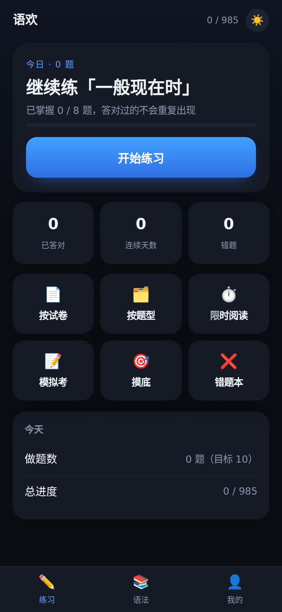
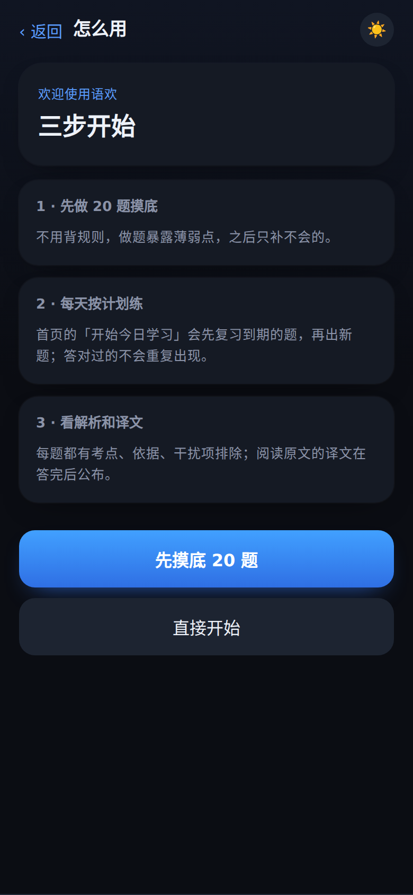
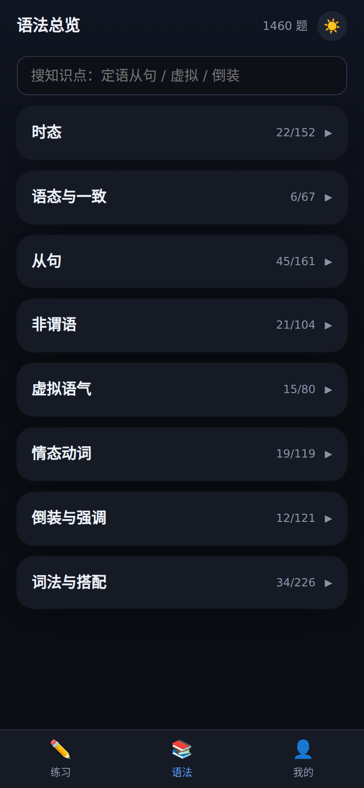
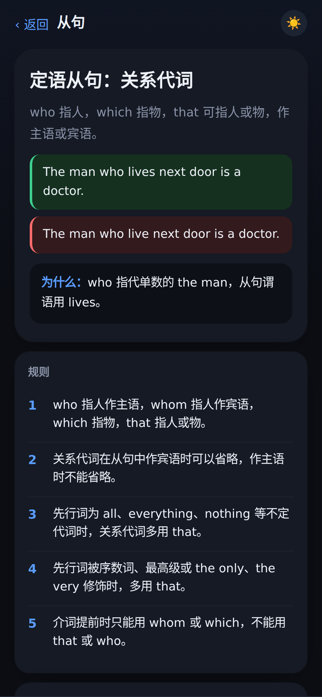
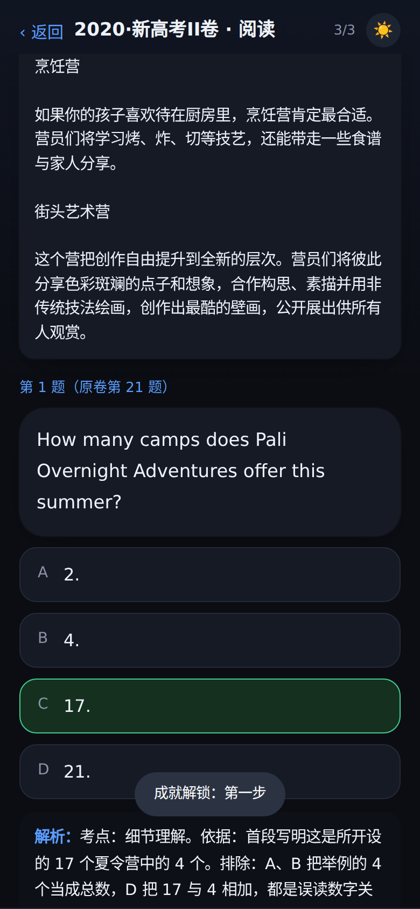
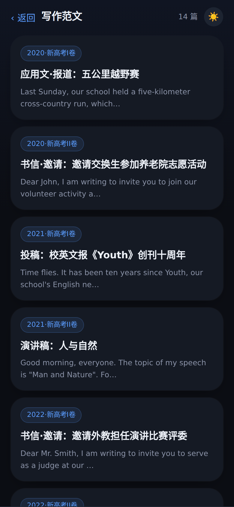

<div align="center">


# 语欢 · 高考英语语法刷题

**一个专注「英语语法」的离线刷题 App** —— 不背单词，只练语法。

[](LICENSE)
[](https://github.com/bhxcvb/yuhuan/releases)
[](#两种用法)
[](#这是干什么的)

[官网](https://bhxcvb.github.io/yuhuan/) · [网页版应用](https://bhxcvb.github.io/yuhuan/web/) · [下载 APK](https://github.com/bhxcvb/yuhuan/releases) · [更新日志](CHANGELOG.md) · [反馈问题](https://github.com/bhxcvb/yuhuan/issues)

</div>

---

## 目录

- [这是干什么的](#这是干什么的)
- [功能](#功能)
- [语法模块](#语法模块)
- [两种用法](#两种用法)
- [本地运行](#本地运行)
- [自己打包 APK](#自己打包-apk)
- [目录结构](#目录结构)
- [数据格式](#数据格式)
- [数据与版权](#数据与版权)
- [常见问题](#常见问题)
- [支持作者](#支持作者)

## 界面

<div align="center">











</div>

## 这是干什么的

单词背得再多，语法题该错还是错。语欢练的是**语法本身**：

- 按**知识点**刷：51 个语法点各自成池，练「一般现在时」就只出一般现在时的题
- 按**题型**刷：阅读、七选五、完形、语法填空、短文改错
- 按**试卷**刷：14 套高考真题，每套 45 题，按原题号顺序
- 每道题都有**详细解析**（考点 + 依据 + 干扰项排除），阅读配**全文译文**

目标：**别背规则，做题 → 暴露薄弱点 → 只补不会的**。

## 功能

| | 能力 |
|---|---|
| 📚 **题库** | 1670 题：14 套真题 630 题 + 分知识点题 985 题 + 综合练习 |
| 🎯 **分知识点练** | 51 个语法点各自成池；答对过的不再重复 |
| 🔁 **间隔复习** | 答对按 1/1/2/4/7/15/30 天安排复习，到期的题自动进今日计划 |
| 🧠 **错因标记** | 答错可标记「概念不清 / 粗心 / 没看懂句子」，错题本按错因归类 |
| 📅 **今日计划** | 先复习到期题，再出新题；按每天题量与考试日期安排 |
| 🔎 **真题索引** | 每个知识点显示「真题里考过 N 次」，可直接跳去做 |
| ⏱ **整卷计时** | 按试卷 45 分钟、模拟考 20 分钟、限时阅读 6 分钟，自动交卷并折算 150 分制 |
| 📄 **按试卷练** | 14 套真题整套练习，看该卷正确率 |
| 🗂 **按题型练** | 阅读 / 七选五 / 完形 / 语法填空 / 短文改错 |
| 📰 **整篇作答** | 阅读与七选五按整篇一次做完，交卷后才给答案、解析和译文 |
| ⏱ **限时阅读** | 随机一篇阅读，6 分钟倒计时，练考场节奏 |
| 📝 **模拟考** | 20 题真题随机抽，按套统计得分 |
| 🎯 **摸底** | 20 题快速诊断 8 大语法模块 |
| 🀄 **译文** | 阅读/七选五全文译文（答题后公布）+ 分知识点题的题干与选项译文 |
| 📖 **语法知识库** | 51 篇：规则、例句、常见错误、易混陷阱 |
| ✍️ **写作范文** | 14 篇高考范文：英文 + 中文译文 + 要点 + 提示 |
| ❌ **错题本** | 自动收录，答对两次移出，可单独重练 |
| 📊 **本周报告** | 最近 7 天每天题量与正确率 |
| 📈 **掌握度** | 8 个模块的掌握度条形图、成就系统 |
| 📖 **生词本** | 长按阅读原文里的单词收录，内置 5500+ 词离线词典，带音标与中文释义 |
| 💾 **备份** | 一键复制 JSON，换设备粘贴恢复 |
| 🌗 **主题** | 日间 / 夜间，跟随系统设置保存 |
| 🗓 **高考倒计时** | 设置考试日期，首页显示剩余天数 |
| 🔊 **朗读** | 调用系统 TTS 朗读题干（无引擎时自动隐藏） |

完全离线：**不联网、不申请任何权限、无账号、无广告**。数据存在本机。

## 语法模块

| 模块 | 知识点 |
|---|---|
| 时态 | 一般现在时、一般过去时、现在完成时、过去完成时、现在进行时、一般将来时、现在完成进行时 |
| 语态与一致 | 被动语态、主谓一致 |
| 从句 | 定语从句（关系代词/关系副词/whose/非限制性）、宾语从句（语序/时态）、主语从句、同位语从句、表语从句、时间/条件/让步/结果状语从句 |
| 非谓语 | 不定式表目的、动名词作主语/宾语、现在分词作状语、过去分词作定语、独立主格 |
| 虚拟语气 | 与现在相反、与过去相反、wish 后从句、建议要求 |
| 情态动词 | 表推测、情态动词+原形、should 表建议、able 与 can、need 的用法 |
| 倒装与强调 | 否定词置首、only+状语、so do I、强调句 |
| 词法与搭配 | 比较级、the more the more、冠词、时间介词、形式主语/宾语 it、both…and、some/any、prefer |

## 两种用法

**网页版**（手机/电脑浏览器直接打开，可添加到主屏幕）

```
https://bhxcvb.github.io/yuhuan/web/
```

**Android APK**

到 [Releases](https://github.com/bhxcvb/yuhuan/releases) 下载 `yuhuan-*.apk`，允许未知来源安装即可（约 390 KB）。

## 本地运行

```bash
git clone https://github.com/bhxcvb/yuhuan.git
cd yuhuan
python3 -m http.server 8080   # 打开 http://127.0.0.1:8080/
```

也可以直接双击 `index.html`。

## 自己打包 APK

需要 JDK、`aapt`、`zipalign`、`apksigner` 和 [R8](https://r8.googlesource.com/r8)（提供 `d8`）：

```bash
ANDROID_JAR=/path/to/android.jar R8_JAR=/path/to/r8.jar ./build/build-apk.sh
```

`app/MainActivity.java` 只做三件事：WebView 加载 `assets/index.html`、返回键交给页面历史、把系统 `TextToSpeech` 暴露给网页。

## 目录结构

```
index.html            官网落地页
web/index.html        完整应用（题库内联，单文件，约 1.4 MB）
screenshots/          界面截图
app/                  Android 外壳（MainActivity + Manifest + 图标）
build/build-apk.sh    一键打包脚本
docs/banner.png       仓库横幅
docs/icon.png         应用图标
reward.webp           赞赏码
```

## 数据格式

题库内联在 `index.html` 里，三个全局变量：

```js
QS[i] = [分类, 题干, [选项...], 正确答案下标, 解析, 来源?, 原文?, 知识点?]
TR[i] = { q: "题干译文", o: ["选项译文"...], p: "原文译文" }
NOS[i] = 题号（真题才有）
```

想换成自己的题库，改这三个变量即可，界面逻辑不用动。

## 数据与版权

- 题目与原文来自历年高考真题，版权归原命题机构；本项目**仅用于学习研究**，权利人提出异议会立即移除。
- 解析、译文为本项目自行撰写。
- 2020–2021、2026 二卷答案对照官方答案卷；2022 年之后官方答案未公开，答案由本项目自行解答。

## 常见问题

**Q：进度会不会丢？**
A：进度存在本机 localStorage，覆盖安装保留。「我的 → 备份/恢复」可导出 JSON 迁移到别的设备。

**Q：为什么朗读没声音？**
A：需要系统有「文字转语音」引擎。没有引擎时朗读按钮会自动隐藏，去系统设置装一个即可。

**Q：能离线用吗？**
A：可以，整个应用是单个 HTML 文件，无任何网络请求。

## 支持作者

如果语欢帮到了你，欢迎扫码支持（完全自愿，不影响任何功能）：


## 许可

代码以 MIT 发布；题目内容的使用请遵守上述说明。
