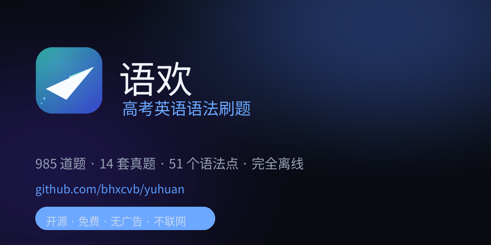
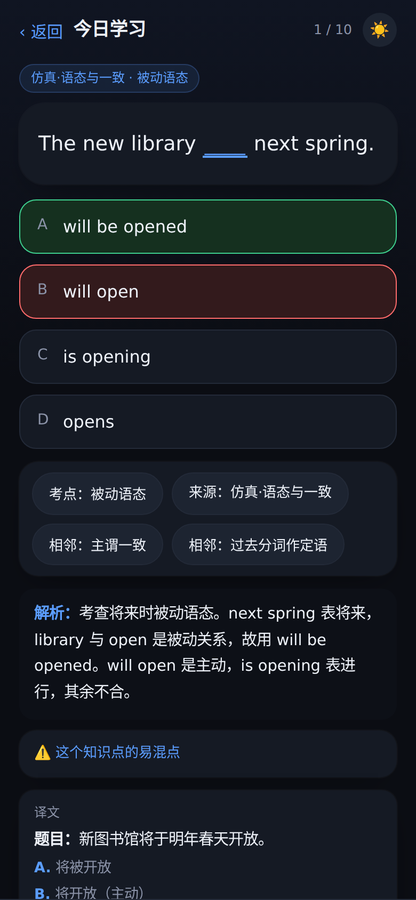
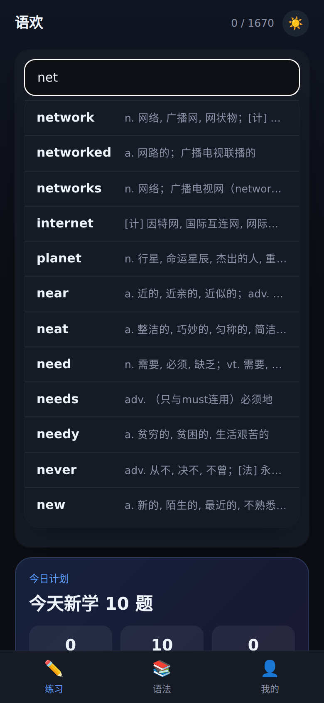

<div align="center">



# 语欢 · 高考英语语法刷题

**不背单词，只练语法。** 14 套高考真题拆成 1670 道题，按 51 个语法点组织，每题都有「考点 + 依据 + 排除」的解析。

[](LICENSE)
[](https://github.com/bhxcvb/yuhuan/releases)
[](#5-usage)
[](#1-overview)
[](https://github.com/bhxcvb/yuhuan/actions)

[安装教程](docs/INSTALL.md) · [官网](https://bhxcvb.github.io/yuhuan/) · [网页版](https://bhxcvb.github.io/yuhuan/web/) · [下载 APK](https://github.com/bhxcvb/yuhuan/releases) · [更新日志](CHANGELOG.md) · [反馈问题](https://github.com/bhxcvb/yuhuan/issues)

</div>

---

## Contents
**目录**

| | | |
|---|---|---|
| [① 这是什么](#1-overview) | [② 功能](#2-features) | [③ 界面](#3-screenshots) |
| [④ 语法模块](#4-grammar) | [⑤ 怎么用](#5-usage) | [⑥ 本地开发](#6-development) |
| [⑦ 目录结构](#7-structure) | [⑧ 数据格式](#8-data-format) | [⑨ 测试](#9-tests) |
| [⑩ 常见问题](#10-faq) | [⑪ 支持作者](#11-support) | [⑫ 许可](#12-license) |
| | | |

## 1. Overview
**这是什么**

单词背得再多，语法题该错还是错。语欢练的是**语法本身**：

- **按知识点刷**：51 个语法点各自成池，练「一般现在时」就只出一般现在时的题
- **按题型刷**：阅读、七选五、完形、语法填空、短文改错
- **按试卷刷**：14 套高考真题，按原题号顺序，整篇阅读一次做完
- **每道题都有解析**：考点 + 原文依据 + 干扰项为什么错；阅读配全文译文

> 目标：**别背规则，做题 → 暴露薄弱点 → 只补不会的。**
>
> 完全离线：不联网、不申请任何权限、无账号、无广告。数据只存在本机。

## 2. Features
**功能**

| | 功能 | 说明 |
|---|---|---|
| 📚 | **题库 1670 题** | 14 套真题 630 题 + 分知识点题 985 题 + 综合练习 |
| 🎯 | **分知识点练** | 51 个语法点各自成池，答对过的不再重复 |
| 🔁 | **间隔复习** | 答对按 1/1/2/4/7/15/30 天安排；到期的题自动进今日计划 |
| 📅 | **今日计划** | 先复习到期题，再出新题；按每天题量与考试日期安排 |
| 🧠 | **错因标记** | 答错标「概念不清 / 粗心 / 没看懂句子」，错题本按原因筛选 |
| 📰 | **整篇作答** | 阅读、七选五整篇一次做完，交卷后才出答案、解析与译文；不进单题流程 |
| 🔎 | **真题索引** | 每个知识点显示「真题里考过 N 次」，点进去看原题 |
| ⏱ | **整卷计时** | 按试卷 45 分钟、模拟考 20 分钟、限时阅读 6 分钟，自动交卷并折算 150 分制 |
| 📖 | **语法知识库** | 51 篇：规则、例句（英文+译文）、常见错误、易混陷阱 |
| 🀄 | **全文译文** | 阅读/七选五全文、完形整篇译文，答题后公布 |
| ✍️ | **写作范文** | 14 篇高分范文：英文 + 译文 + 要点 + 提示 |
| 🔤 | **首页查词** | 输入字母实时联想想似单词，带音标与释义 |
| 📖 | **生词本** | 长按任意英文单词弹卡片，一键收录；内置 26,883 词离线词典 |
| 📊 | **学习数据** | 周报、模块掌握度条形图、8 个成就徽章、高考倒计时 |
| 🌗 | **主题** | 日间 / 夜间 + 6 种主题色 |
| 💾 | **备份** | 一键复制 JSON，换设备粘贴恢复 |
| 🔄 | **更新检查** | 打开时静默检查新版本（可在设置关闭），发现新版本首页提示 |
| 🧾 | **错误日志** | 本地记录异常，可一键复制用于反馈 |

## 3. Screenshots
**界面**

<table>
<tr>
<td align="center"><br><sub>首页 · 今日计划与查词</sub></td>
<td align="center"><br><sub>答题</sub></td>
<td align="center"><br><sub>答后解析与译文</sub></td>
</tr>
<tr>
<td align="center"><br><sub>整篇作答 · 交卷后展示</sub></td>
<td align="center"><br><sub>知识点详情 · 知识库 + 真题索引</sub></td>
<td align="center"><br><sub>我的 · 掌握度与成就</sub></td>
</tr>
<tr>
<td align="center"><br><sub>查词联想</sub></td>
<td align="center"><br><sub>写作范文</sub></td>
<td align="center"><br><sub>语法总览</sub></td>
</tr>
</table>

## 4. Grammar
**语法模块**

| 模块 | 知识点 |
|---|---|
| **时态** | 一般现在时、一般过去时、现在完成时、过去完成时、现在进行时、一般将来时、现在完成进行时 |
| **语态与一致** | 被动语态、主谓一致 |
| **从句** | 定语从句（关系代词 / 关系副词 / whose / 非限制性）、宾语从句（语序 / 时态）、主语从句、同位语从句、表语从句、时间 / 条件 / 让步 / 结果状语从句 |
| **非谓语** | 不定式表目的、动名词作主语 / 宾语、现在分词作状语、过去分词作定语、独立主格 |
| **虚拟语气** | 与现在相反、与过去相反、wish 后从句、建议要求 |
| **情态动词** | 表推测、情态动词 + 原形、should 表建议、able 与 can、need 的用法 |
| **倒装与强调** | 否定词置首、only + 状语、so do I、强调句 |
| **词法与搭配** | 比较级、the more the more、冠词、时间介词、形式主语 / 宾语 it、both…and、some / any、prefer |

## 5. Usage
**下载与安装**

| 平台 | 怎么装 | 体积 | 需要什么 |
|---|---|---|---|
| **Android** | 下载 [APK](https://github.com/bhxcvb/yuhuan/releases/download/v6.10/yuhuan-v6.10.apk)，允许未知来源安装 | 1.3 MB | 无 |
| **iPhone / iPad** | Safari 打开[网页版](https://bhxcvb.github.io/yuhuan/web/) → 分享 → **添加到主屏幕** | 0（浏览器缓存） | 无 |
| **Windows（推荐）** | Edge/Chrome 打开网页版 → 地址栏 **安装** 图标 | 0 | 系统自带浏览器 |
| **Windows（独立包）** | 下载 [yuhuan-windows-x64.zip](https://github.com/bhxcvb/yuhuan/releases/download/v6.10/yuhuan-windows-x64.zip)，解压双击 `语欢.exe` | 100 MB | 无（自带浏览器） |
| **macOS** | Chrome/Edge 打开网页版 → 安装 | 0 | 无 |
| **源码运行** | `python3 -m http.server` 后打开 `web/` | — | Python |

> iPhone 和 Windows 的「安装」都是 PWA：装完有独立图标、全屏运行、断网可用，和原生 App 体验一致。
> **iOS 原生 App** 需要 Mac + Xcode + 苹果开发者账号（99 美元/年），本仓库提供[工程源码](ios/README.md)与 Codemagic 配置，但没有 Mac 无法产出 .ipa。

详细步骤（含常见问题、数据迁移）见 **[安装教程](docs/INSTALL.md)**。

## 6. Development
**本地开发**

```bash
git clone https://github.com/bhxcvb/yuhuan.git
cd yuhuan
python3 -m http.server 8080     # 打开 http://127.0.0.1:8080/web/
```

**打包 APK**：需要 JDK、`aapt`、`zipalign`、`apksigner` 和 [R8](https://r8.googlesource.com/r8)（提供 `d8`）

```bash
ANDROID_JAR=/path/to/android.jar R8_JAR=/path/to/r8.jar ./build/build-apk.sh
```

`app/MainActivity.java` 只做三件事：WebView 加载 `assets/index.html`、返回键交给页面历史、把系统 `TextToSpeech` 暴露给网页。

## 7. Structure
**目录结构**

```
index.html            官网落地页
web/index.html        完整应用（题库内联，单文件，约 2.4 MB）
app/                  Android 外壳（MainActivity + Manifest + 图标）
build/build-apk.sh    一键打包脚本
screenshots/          界面截图
docs/                 横幅、图标、二维码
.github/workflows/    CI：推送时校验脚本语法与题库结构
```

## 8. Data format
**数据格式**

题库内联在 `web/index.html`，几个全局变量：

```js
QS[i] = [分类, 题干, [选项...], 正确答案下标, 解析, 来源?, 原文?, 知识点?]
TR[i] = { q: "题干译文", o: ["选项译文"...], p: "原文译文" }
NOS[i] = 题号（真题才有）
KB[知识点] = { summary, rules[], examples[], mistakes[], trap }
DICT[word] = { t: "中文释义", p: "/音标/" }
```

想换成自己的题库，改这些变量即可，界面逻辑不用动。

## 9. Tests
**测试**

```bash
node tests/basic.test.js                          # 92 项基础回归（无依赖）
python3 tests/e2e.py                              # 21 项端到端（需 Playwright）
```

CI 每次 push 跑这两个 job：`基础回归`（题库结构、出题规则、答题流程、间隔复习、词典、更新检查、错误日志）和 `端到端`（真实 Chromium 里的交互与无报错）。细节见 [tests/README.md](tests/README.md)。

## 10. FAQ
**常见问题**

<details>
<summary><b>进度会不会丢？</b></summary>

进度存在本机 localStorage，覆盖安装保留。「我的 → 备份 / 恢复」可导出 JSON 迁移到别的设备。
</details>

<details>
<summary><b>为什么朗读没声音？</b></summary>

需要系统有「文字转语音」引擎。没有引擎时朗读按钮会自动隐藏，去系统设置安装一个即可。
</details>

<details>
<summary><b>能离线用吗？</b></summary>

可以，整个应用是单个 HTML 文件，无任何网络请求。
</details>

<details>
<summary><b>答案准确吗？</b></summary>

2020–2021、2026 二卷对照官方答案卷；2022 年之后官方答案未公开，答案由本项目自行解答并交叉校验。
</details>

## 11. Support
**支持作者**

如果语欢帮到了你，欢迎扫码支持（完全自愿，不影响任何功能）：


也欢迎点个 ⭐️ Star，或提 [Issue](https://github.com/bhxcvb/yuhuan/issues) 反馈问题、推荐题目。

## 12. License
**许可**

代码以 MIT 发布；题目内容版权归原命题机构，仅用于学习研究，权利人提出异议会立即移除。

---

<div align="center"><sub>语欢 · 与语言相欢 · Made with ❤️ for Gaokao</sub></div>
