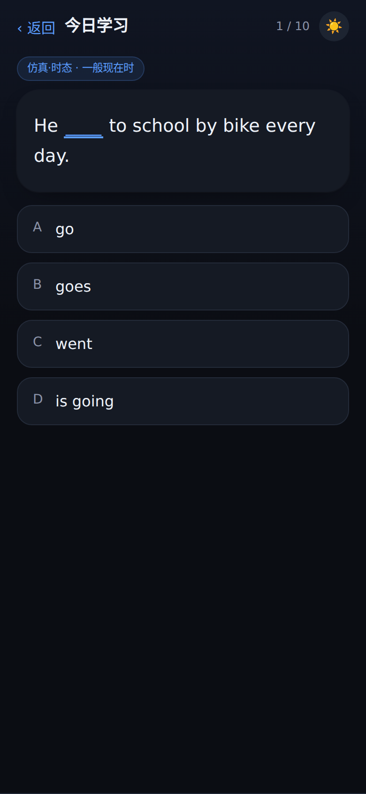
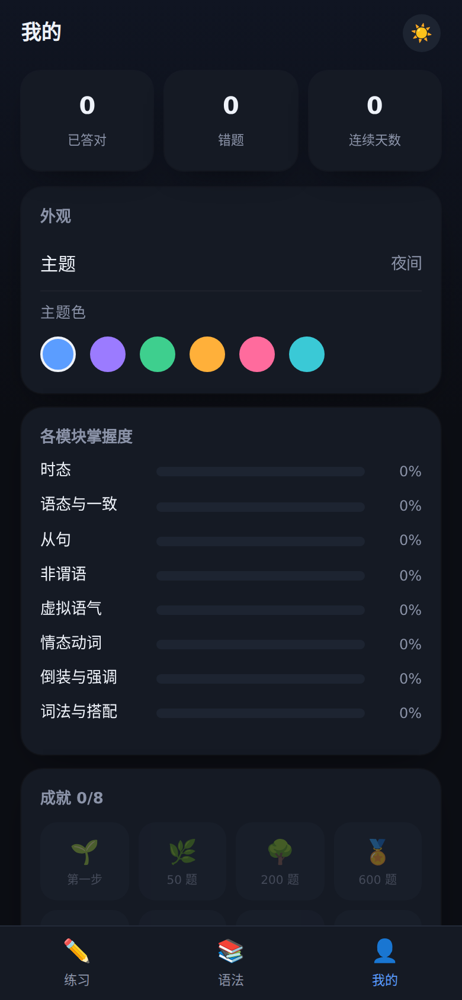
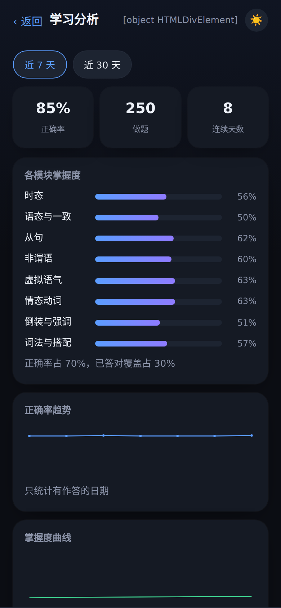
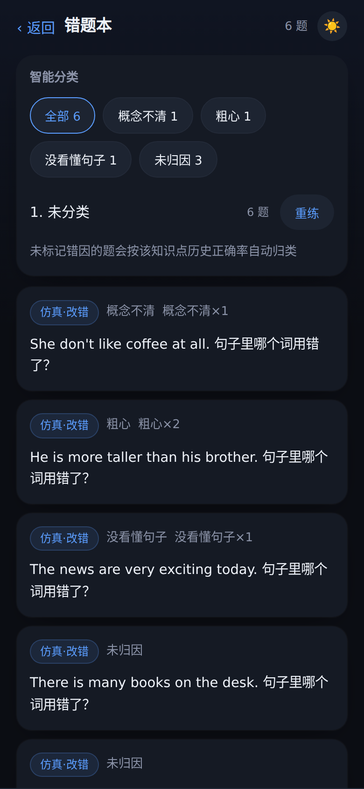
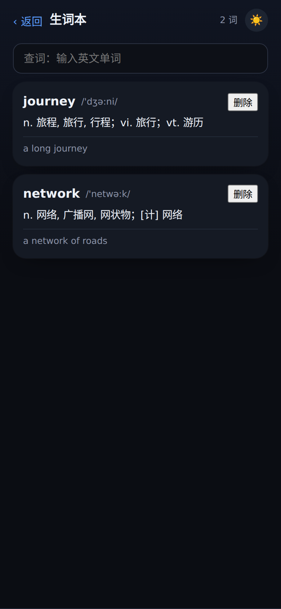

<div align="center">


# 语欢 · 高考英语语法刷题

**单词背了不少，语法题还是一错一大片？** 语欢就是为这种情况做的：14 套高考真题拆成 1460 道题，按 51 个语法点组织；每道题都有「考点 + 依据 + 排除」的结构化解析，阅读与七选五配全文译文。不背单词，只练语法。

[](LICENSE)
[](https://github.com/bhxcvb/yuhuan/releases/latest)
[](#5-usage)
[](https://github.com/bhxcvb/yuhuan/actions/workflows/check.yml)


### [▶️ 在线体验（不用下载）](https://bhxcvb.github.io/yuhuan/web/)

[📦 下载 APK](https://github.com/bhxcvb/yuhuan/releases/latest) · [📖 安装教程](docs/INSTALL.md) · [🏠 官网](https://bhxcvb.github.io/yuhuan/) · [📝 更新日志](CHANGELOG.md) · [🐛 反馈](https://github.com/bhxcvb/yuhuan/issues)

**离线优先**：做题、复习、查词全部不需要网络；无账号、无广告、无埋点。Android 版只申请「网络」权限用于检查更新（可在设置关闭），朗读用系统 TTS。

</div>

---

## Contents
**目录**

| | | |
|---|---|---|
| [① 这是什么](#1-overview) | [② 功能](#2-features) | [③ 界面](#3-screenshots) |
| [④ 语法模块](#4-grammar) | [⑤ 怎么用](#5-usage) | [⑥ 本地开发](#6-development) |
| [⑦ 目录结构](#7-structure) | [⑧ 数据格式](#8-data-format) | [⑨ 测试](#9-tests) |
| [架构说明](docs/ARCHITECTURE.md) | [平台测试清单](docs/PLATFORM_TEST.md) | [安全说明](SECURITY.md) |
| [⑩ 常见问题](#10-faq) | [⑪ 支持作者](#11-support) | [⑫ 许可](#12-license) |
| | | |

## 1. Overview
**这是什么**

市面上的刷题 App 大多是「题库 + 对答案」。语欢多做三件事：

1. **知道你不会什么**：按知识点统计正确率、错因和复习表现，给出五级诊断（未练 / 样本不足 / 明显薄弱 / 待巩固 / 稳定掌握）
2. **知道该练什么**：每日计划按「复习 → 补薄弱 → 新题」动态配比；薄弱点只出变式题，不重复刚做过的原题
3. **知道为什么错**：每题给出考点、判断依据、解题步骤和逐项排除；易混点只在和本题相关时展示

> 目标：**别背规则，做题 → 暴露薄弱点 → 只补不会的。**

## 2. Features
**功能**

### 学习闭环

| | 功能 | 说明 |
|---|---|---|
| 📅 | **动态每日计划** | 按到期复习、薄弱点、新题自动配比；考试临近自动降低新题比例；完成可「加练」 |
| 🔁 | **间隔复习** | 1/2/4/7/15/30/60 天；答错当天重练、连错两次推到次日；逾期和低正确率自动缩短间隔 |
| 🧠 | **学习诊断** | 51 个知识点五级判定；按错因（概念不清 / 粗心 / 没看懂句子）给不同建议 |
| 🎯 | **薄弱点变式训练** | 只出同知识点的其他题；原题推迟到次日，避免机械重复 |
| 📊 | **掌握度** | 平滑正确率 50% + 覆盖度 20% + 连续复习 30%；小样本自动封顶，答对一次不算掌握 |
| 📈 | **学习报告** | 7/30 天切换，正确率趋势、每日题量、新增掌握题、薄弱点、下一阶段建议 |
| 🏆 | **成就与连续天数** | 8 个成就徽章，连续学习记录 |

### 题目与解析

| | 功能 | 说明 |
|---|---|---|
| 📚 | **题库 1460 题** | 14 套真题 420 题（阅读 210 / 七选五 70 / 语法填空 140）+ 分知识点题 1040 题 |
| 📰 | **整篇作答** | 阅读、七选五整篇一次做完，交卷后才公布答案、解析与译文 |
| 🧩 | **结构化解析** | 解题步骤 → 解析 → 选项排除表（正确项与错项各自说明） |
| 🀄 | **全文译文** | 阅读 / 七选五全文译文，交卷后公布 |
| ⚠️ | **易混点匹配** | 只展示与本题相关的内容；不相关时折叠并标注「本知识点的其他易混点」 |
| ⏱ | **计时模式** | 整卷 45 分钟、模拟考 20 分钟、限时阅读 6 分钟，自动交卷并折算 150 分 |
| ✍️ | **写作范文** | 14 篇高分范文：英文 + 译文 + 要点 + 提示 |

### 词汇

| | 功能 | 说明 |
|---|---|---|
| 🔤 | **查词** | 英文前缀 / 包含 / 中文反查（如「网络」→ network） |
| 📖 | **词汇拓展** | 近义词、反义词、英文释义、相关词组；近义词按词性对齐，避免词义混用 |
| 🔊 | **发音** | 英式 / 美式切换（Web 用系统语音，Android 用原生 TTS） |
| 📝 | **单词复习** | 生词可加入间隔复习，卡片式「认识 / 模糊 / 不认识」 |
| ⭐ | **生词本** | 音标 + 释义 + 例句 + 近义词；变形词自动归并到原形，不重复收藏 |

### 数据与安全

| | 功能 | 说明 |
|---|---|---|
| 💾 | **备份** | 复制文本 / 保存文件 / 从文件导入；导入前自动备份、可撤销 |
| 🗄 | **自动快照** | 每次保存写入 IndexedDB，保留上一份快照，可回滚 |
| 🧬 | **版本迁移** | schema 迁移；旧版本数据自动升级，进度不丢 |
| 📦 | **题库可替换** | 导入题库 JSON，各题库进度互相独立 |
| 🧾 | **错误日志** | 本地记录异常，一键复制用于反馈 |
| 🔄 | **更新检查** | 打开时静默查询 GitHub 版本，可在设置关闭 |

## 3. Screenshots
**界面**

<table>
<tr>
<td align="center"><br><sub>首页 · 学习计划与查词</sub></td>
<td align="center"><br><sub>答题</sub></td>
<td align="center"><br><sub>解题步骤 + 选项排除</sub></td>
</tr>
<tr>
<td align="center"><br><sub>整篇作答 · 交卷后展示</sub></td>
<td align="center"><br><sub>知识点 · 规则与真题索引</sub></td>
<td align="center"><br><sub>我的 · 掌握度与成就</sub></td>
</tr>
<tr>
<td align="center"><br><sub>学习分析</sub></td>
<td align="center"><br><sub>错题本 · 按错因变式</sub></td>
<td align="center"><br><sub>生词本 · 单词复习</sub></td>
</tr>
</table>

## 4. Grammar
**语法模块**

| 模块 | 知识点 |
|---|---|
| **时态** | 一般现在时、一般过去时、现在完成时、过去完成时、现在进行时、一般将来时、现在完成进行时 |
| **语态与一致** | 被动语态、主谓一致 |
| **从句** | 定语从句（关系代词 / 关系副词 / whose / 非限制性）、宾语从句（语序 / 时态）、主语从句、同位语从句、表语从句、时间 / 条件 / 让步 / 结果状语从句 |
| **非谓语** | 不定式表目的、动名词作主语 / 宾语、现在分词作状语、过去分词作定语、独立主格 |
| **虚拟语气** | 与现在相反、与过去相反、wish 后从句、建议要求 |
| **情态动词** | 表推测、情态动词 + 原形、should 表建议、able 与 can、need 的用法 |
| **倒装与强调** | 否定词置首、only + 状语、so do I、强调句 |
| **词法与搭配** | 比较级、the more the more、冠词、时间介词、形式主语 / 宾语 it、both…and、some / any、prefer |

## 5. Usage
**下载与安装**

| 平台 | 怎么装 | 体积 | 需要什么 |
|---|---|---|---|
| **Android** | 在 [最新 Release](https://github.com/bhxcvb/yuhuan/releases/latest) 下载 `yuhuan-v*.apk`，允许未知来源安装 | 3.0 MB | 无 |
| **iPhone / iPad** | Safari 打开[网页版](https://bhxcvb.github.io/yuhuan/web/) → 分享 → **添加到主屏幕** | 0（浏览器缓存） | 无 |
| **Windows / macOS** | Edge / Chrome 打开网页版 → 地址栏安装图标 | 0 | 系统浏览器 |
| **源码运行** | `python3 -m http.server` 后打开 `web/` | — | Python |

详细步骤（含常见问题、数据迁移）见 **[安装教程](docs/INSTALL.md)**。

## 6. Development
**本地开发**

```bash
# 1. 改界面/逻辑：编辑 src/app-template.html
# 2. 重建单文件产物（数据从现有 web/index.html 自举）
node tools/build-app.js

# 只校验产物和模板是否一致（CI 用）
node tools/build-app.js --check
```

重新生成 APK（需要 JDK、Android SDK build-tools、aapt、zipalign、apksigner）：

```bash
bash build_release.sh 6.33      # 版本号唯一来源，输出 APK 与 web 版
```

## 7. Structure
**目录结构**

```
src/app-template.html   界面与逻辑（带数据占位符）
tools/build-app.js      模板 + 数据 → web/index.html
tools/validate-data.js  题库结构校验
apk/                    Android 壳工程与打包脚本
web/                    构建产物（GitHub Pages 直接可用）
tests/                  基础回归 / 端到端 / 离线测试
docs/                   架构、安装、平台清单、头图
```

## 8. Data Format
**数据格式**

```js
QS[i] = [语法分类, 题干, [选项...], 答案下标, 解析, 来源?, 原文?, 知识点?]
TR[i] = { q: "题干译文", o: ["选项译文"...], p: "原文译文" }
NOS[i] = 原题题号（真题才有）
KB[知识点] = { summary, rules[], examples[], mistakes[], trap }
DICT[word] = { t: "中文释义", p: "/音标/", e: "英文例句", s: [近义词...] }
EX[word] = { de: "英文释义", pos, syn: [近义词], a: [反义词], ph: [相关词组] }
```

导入自定义题库：`我的 → 备份/恢复 → 题库 → 导入题库`，格式 `{"QS":[…],"TR":{…},"NOS":{…}}`；导入前自动备份，可撤销。

## 9. Tests
**测试**

```bash
node tools/extract-data.js /tmp/data.json && node tools/validate-data.js /tmp/data.json   # 题库结构校验
node tests/basic.test.js          # 344 项基础回归（无依赖）
python3 tests/e2e.py              # 21 项端到端（需 Playwright）
python3 tests/e2e_ext.py          # 20 项离线 / 数据完整性 / 备份恢复
```

CI 每次 push 跑：题库校验、基础回归、端到端。细节见 [tests/README.md](tests/README.md)。

**性能**：单文件约 9.8 MB，首屏 `DOMContentLoaded` 约 0.5 s（词典与词汇拓展懒加载）；无 ES6+ 语法，兼容旧内核。

## 10. FAQ
**常见问题**

**Q：需要联网吗？**
做题、复习、查词都不需要。只有「检查更新」会访问 GitHub（默认开启，可关闭）。

**Q：数据存在哪？**
只存本机：localStorage 保存进度，IndexedDB 保存自动快照。不上传任何数据。

**Q：换手机怎么办？**
我的 → 备份/恢复 → 复制或保存文件 → 新设备粘贴/导入。导入前会自动备份当前数据。

**Q：为什么答错后这道题又出现了？**
同一题最多重做 1 次，帮你当场巩固；之后进错题本，隔天用变式题复习。

**Q：为什么只有部分词有反义词/搭配？**
数据来自离线词库与题库语料，没有可靠数据时页面会明确写「暂无可靠数据」，不会编造。

**Q：iOS 原生 App？**
需要 Mac + Xcode + 开发者账号，仓库里有工程骨架（`ios/`），但发不了现成 ipa；iPhone 建议直接用 PWA。

**Q：APK 签名指纹？**
校验下载包（`apksigner verify --print-certs`）：
`SHA-256: 44:40:36:B3:58:8B:D0:17:81:47:B9:65:13:E0:E9:1A:9C:A6:B9:F4:08:7A:F7:46:40:C2:B5:79:11:DF:64:14`。同指纹才能覆盖安装并保留进度。

## 11. Support
**支持作者**

如果语欢帮到了你，可以扫码支持，完全自愿；也欢迎提 Issue 反馈题目或建议。


## 12. License
**许可**

[MIT](LICENSE)。题库与真题版权归原命题机构，本项目仅供学习研究。
